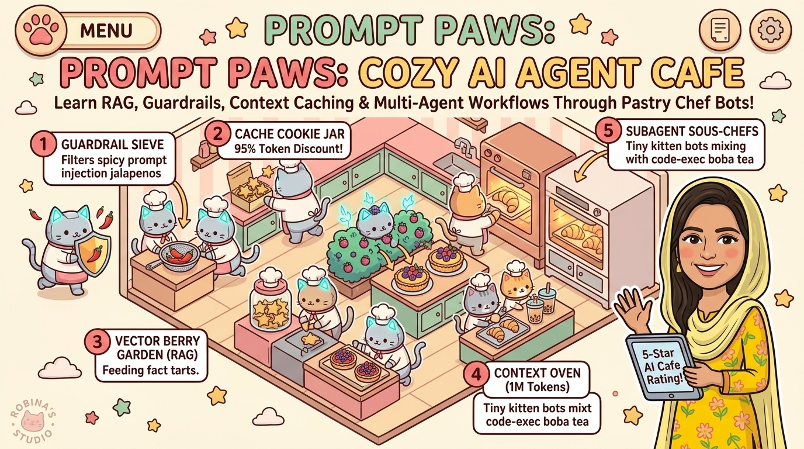
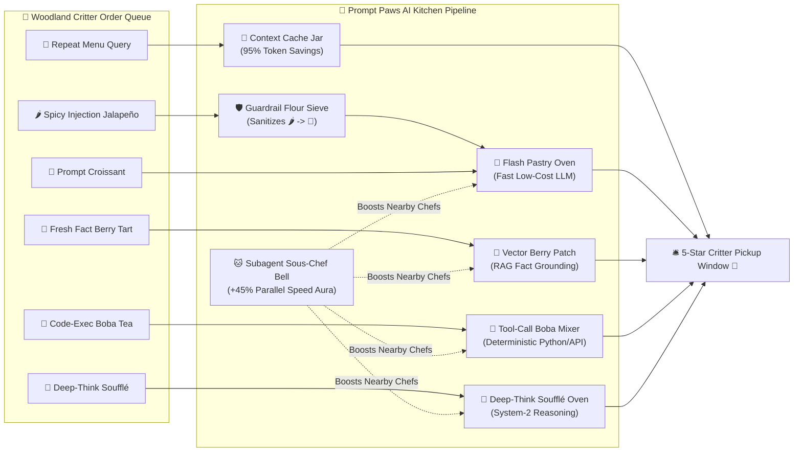

# 🐾🥐 Prompt Paws: The Cozy AI Agent Cafe & Bakery

> **Author & Architect:** [Robina Mirbahar](https://github.com/RobinaMirbahar) (Google Developer Expert in Cloud & AI)  
> **Focus:** Interactive Gamified Simulation Teaching RAG, Guardrails, Context Caching & Multi-Agent Workflows

---

## 🎯 Why I Built Prompt Paws: The Cozy 60 FPS AI Agent Cafe & Bakery (Engineering Purpose & Real-World Value)

### 1. 🐾 Teaching Production AI Engineering Through Cozy Gameplay
Dense architectural whitepapers on Context Caching, RAG latency, and Prompt Injection Guardrails can intimidate newcomers. I designed *Prompt Paws* to turn every core AI engineering pattern into an intuitive mechanic inside a 60 FPS cozy cat cafe.

### 2. 🥐 Every Cafe Station Maps 1-to-1 to a Real LLM Subsystem
In my simulation, the Recipe Book is **Vector RAG**, the Warm Pastry Case is **Context Caching** (slashing latency and token cost), the Health Inspector is **Deterministic Guardrails**, and the Kitchen Crew is **Multi-Agent Orchestration**.

### 3. 🎮 Live Telemetry HUD for Workshops & Classrooms
As players fulfill customer orders, a live HUD tracks p95 latency, token budget, and hallucination rates in real time.

---

> **A cozy, pastel kawaii 2D AI Systems & Agent Engineering simulation game where adorable Robot-Cat Chefs teach you Context Caching, Input Guardrails, RAG Grounding, Tool Calling, System-2 Reasoning, and Multi-Agent Orchestration!**

[](https://robinamirbahar.github.io/cozy-ai-agent-cafe-game/)
[](https://robinamirbahar.github.io/cozy-ai-agent-cafe-game/)
[](https://robinamirbahar.github.io/cozy-ai-agent-cafe-game/)



---

## 🎮 Play Directly in Your Browser!

👉 **[Launch Prompt Paws: The Cozy AI Agent Cafe & Bakery](https://robinamirbahar.github.io/cozy-ai-agent-cafe-game/)**

---

## 🎯 What Is This Game & How Do You Play? (30-Second Guide)

**Prompt Paws** is a **cozy Tower-Defense & Kitchen-Management game for AI Agent Architecture**!
Instead of fighting monsters, you are the **Head AI Pastry Architect** running a pastel bakery:
- **Customer Pastry Orders (`🥐`, `🍪`, `🌶️`, `🍓`, `🧋`, `🍮`) = Incoming User Prompts** moving along the bakery conveyor belt toward the **Pickup Window (`🛎️`)**.
- **Robot-Cat Kitchen Stations = Real-World AI Engineering Components** (Fast LLMs, Context Caches, Input Guardrails, RAG Vector DBs, Deterministic Tool Callers, System-2 Reasoning Models, and Multi-Agent Sous-Chefs) that intercept and process prompts before they reach the customer!
- **How You Win or Lose:** If an order is baked by the right AI Chef Station, you earn **🪙 Star Coins**! If an unbaked order, an ungrounded **👻 Hallucination Puff**, or a sneaky **🌶️ Prompt Injection** slips all the way to the Pickup Window, you lose a **💖 Cafe Heart**!


### 🕹️ How to Play in 3 Easy Steps:
1. **STEP 1 — Pick an AI Chef Station (Left Menu):** Click a station card on the left sidebar (start with **🥐 Flash Pastry Oven** for `🪙 60`). Look at the **Order Forecast chips** under the level story to see which prompt types are coming!
2. **STEP 2 — Click Any `[➕ Slot]` Tile on the Map:** Click one of the 8 pastel counter pads (`Slot 1`–`Slot 8`) beside the conveyor belt to place your Robot-Cat Chef. *(Tip: Click a placed chef anytime to **⬆️ Upgrade** its baking speed or **🧹 Refund** it!)*
3. **STEP 3 — Click `▶️ Open Cafe` (or `✨ Auto-Chef Blueprint`):**
   - Click **`▶️ Open Cafe`** (or press `Spacebar`) to start the shift and watch your Robot-Cat Chefs bake!
   - **Want to watch an instant demo first?** Click **`✨ Auto-Chef Blueprint`** in the top bar and the game will automatically build the optimal AI pipeline for the current level and run it for you!

---

## ✨ Why Another System Design Game—But Cozy?

While dark cyberpunk server-defense games teach cloud infrastructure through DDoS lasers and exploding servers, **Prompt Paws** reimagines **modern AI Agent Architecture** as a warm, stress-free, pastel pastry kitchen!

Friendly woodland critters (🐰 Bunnies, 🦉 Owls, 🦊 Foxes, 🐼 Pandas, 🐶 Corgis—and sneaky 🦝 Raccoon Pranksters!) line up at the counter ordering different AI-powered treats. Your job as **Head AI Pastry Architect** is to place and upgrade 7 specialized **Robot-Cat Chef Stations** along the winding bakery ribbon so every order is grounded, safe, and baked on time!

---

## 🧁 AI Engineering Concepts Mapped to Cozy Bakery Stations

| Bakery Station | Cost | Real-World AI Engineering Concept | What It Does in the Kitchen |
| :--- | :---: | :--- | :--- |
| **🥐 Flash Pastry Oven** | `🪙 60` | **Fast Lightweight LLM (Gemini Flash)** | Bakes everyday **Prompt Croissants** (`🥐`) with low latency and minimal token cost. |
| **🍪 Context Cache Jar** | `🪙 75` | **Prefix & Context Caching (95% Discount)** | Instantly serves repeated **Owl Menu Queries** (`🍪`) at 3× speed with a **+40% Star Coin bonus**! |
| **🛡️ Guardrail Flour Sieve** | `🪙 70` | **Input Safety & Prompt-Injection Filter** | Catches sneaky **Spicy Prompt-Injection Jalapeños** (`🌶️`) before they reach your ovens and sanitizes them into safe Croissants! |
| **🍓 Vector Berry Patch** | `🪙 85` | **RAG (Retrieval-Augmented Generation)** | Harvests fresh factual berries for **RAG Berry Tarts** (`🍓`) so ungrounded ovens never serve **👻 Hallucination Puffs**! |
| **🧋 Tool-Call Boba Mixer** | `🪙 90` | **Deterministic Function Calling & Code Exec** | Executes exact Python math & live API recipes for **Code Boba** (`🧋`) orders instead of guessing probabilities. |
| **🍮 Deep-Think Soufflé Oven** | `🪙 110` | **Extended Thinking / System-2 Reasoning** | Deliberates step-by-step to bake delicate multi-constraint **Reasoning Soufflés** (`🍮`). |
| **🐱 Subagent Sous-Chef Bell** | `🪙 95` | **Multi-Agent Parallel Delegation** | Orchestrates helper cat-paws that boost all nearby stations by **+35% to +65% speed**! |

---

## 🗺️ Cozy AI Kitchen Architecture (Mermaid Diagram)



---

## 📖 7 Story Shifts (Curriculum)

1. **Day 1: Grand Opening! (Fast LLM Routing)** — Learn throughput vs. latency using **🥐 Flash Pastry Ovens**.
2. **Day 2: The Deja-Vu Morning Rush (Context Caching)** — Use the **🍪 Context Cache Jar** to serve repeated system-prompt queries at a fraction of the cost.
3. **Day 3: Spicy Raccoon Pranksters! (Guardrails)** — Place **🛡️ Guardrail Flour Sieves** at the front of the pipeline to neutralize prompt-injection attacks.
4. **Day 4: Fresh Fact Berry Tarts (RAG & Grounding)** — Prevent **👻 Hallucination Puffs** by grounding orders with the **🍓 Vector Berry Patch**.
5. **Day 5: Boba Math & API Rush (Tool Calling)** — Add the **🧋 Tool-Call Boba Mixer** for deterministic code execution.
6. **Day 6: The Royal Soufflé Puzzle (System-2 Reasoning)** — Route complex multi-step soufflés to the **🍮 Deep-Think Soufflé Oven**.
7. **Day 7: Grand Festival Banquet! (Multi-Agent Sous-Chefs)** — Combine all stations with **🐱 Subagent Sous-Chef Bells** to survive the ultimate festival rush!

---

## 🛠️ Key Features

- **✨ One-Click "Auto-Chef Blueprint"**: Want to see the optimal AI architecture for any shift immediately? Click **✨ Auto-Chef Blueprint** in the top bar and watch the Robot-Cat Chefs orchestrate the entire pipeline!
- **🐱‍🍳 Live AI Architecture Linter ("Chef Whiskers")**: Real-time static analysis of your kitchen layout warns you if your pipeline is vulnerable to prompt injections, ungrounded RAG hallucinations, or uncached token waste.
- **🎵 Procedural WebAudio Cafe Synthesizer**: Cozy, zero-dependency chimes, oven dings, cache-hit pops, and victory chords generated dynamically via the Web Audio API.
- **⚡ Zero Build Step**: Pure ES6 + HTML5 Canvas (`index.html`, `styles.css`, `audio.js`, `levels.js`, `game.js`). Clone or open `index.html` directly in any browser!

---

## 🚀 Run Locally in 5 Seconds

```bash
git clone https://github.com/RobinaMirbahar/cozy-ai-agent-cafe-game.git
cd cozy-ai-agent-cafe-game
# Open index.html directly in your browser or serve with any static server:
npx serve .
```

---

## 📚 Documentation & Walkthrough

- [Implementation Plan (`docs/IMPLEMENTATION_PLAN.md`)](docs/IMPLEMENTATION_PLAN.md)
- [Gameplay & Architecture Walkthrough (`docs/WALKTHROUGH.md`)](docs/WALKTHROUGH.md)

---

*Designed & built with 💖 and 🐾 by **Robina Mirbahar**.*


---

### 🚀 Featured Google Cloud & Agentic AI Portfolio by Robina Mirbahar

| Repository | Architecture & Focus | Live Status |
| :--- | :--- | :--- |
| **[gemma4-multilora-adk-eval](https://github.com/RobinaMirbahar/gemma4-multilora-adk-eval)** | Dynamic Multi-LoRA Hot-Swapping & CI/CD Agent Evaluation (`adk eval`) on Cloud Run GPUs with Gemma 4 & vLLM |   |
| **[slothsre-napops](https://github.com/RobinaMirbahar/slothsre-napops)** | SlothSRE ("NapOps") — Overnight Gemma 4 & Google ADK Incident Digest Agent with OpenTelemetry & Sentry AI Monitoring |   |
| **[streamforge-event-adk](https://github.com/RobinaMirbahar/streamforge-event-adk)** | Real-Time Event-Driven Multi-Agent Pipelines on Google Cloud with ADK (`ParallelAgent` & `LoopAgent`), Eventarc & Pub/Sub |   |
| **[a2a-mcp-mesh-cloudrun](https://github.com/RobinaMirbahar/a2a-mcp-mesh-cloudrun)** | Agent-to-Agent (A2A) & Multi-MCP Mesh on Cloud Run with Gemma 4, Google ADK, Spanner Graph & AlloyDB |   |
| **[cloudguard-gemma-agent](https://github.com/RobinaMirbahar/cloudguard-gemma-agent)** | 6-Part Production Gemma Enterprise Agent Series (ADK, Cloud Run L4 GPU, Firestore, Model Armor, Vertex AI QLoRA) |   |
| **[Comic-Studio-Ai](https://github.com/RobinaMirbahar/Comic-Studio-Ai)** | Multi-Agent Comic Generator powered by Google Gemini API & FastAPI deployed on Google Cloud Run |   |
| **[vertex-ai-imagen3](https://github.com/RobinaMirbahar/vertex-ai-imagen3)** | Generate AI-powered product & editorial images using Google Vertex AI Imagen 3 in Google Colab |   |
| **[Python-Learning-Assistant](https://github.com/RobinaMirbahar/Python-Learning-Assistant)** | AI-powered Python tutor covering 50+ interactive exercises with real-time feedback built with Streamlit + Gemini API |   |
| **[cozy-ai-agent-cafe-game](https://github.com/RobinaMirbahar/cozy-ai-agent-cafe-game)** | Prompt Paws: 60 FPS Cozy AI Agent Bakery Simulation Game teaching RAG, Guardrails, Context Caching & Multi-Agent Loops |   |

<div align="center">
  
</div>

<!-- AUTHOR_SIGNATURE_START -->
---

## 👩‍💻 About the Author

**Robina Mirbahar — Google Cloud & AI Architect**  
*Google Developer Expert (GDE) in Cloud & AI • Published Author • Multi-Agent Systems & Serverless GPU Builder*

[](https://github.com/RobinaMirbahar)
[](https://medium.com/@robinamirbahar)
[](https://dev.to/robinamirbahar)
[](https://www.linkedin.com/in/robina-mirbahar)
[](https://g.dev/RobinaMirbahar)
[](https://www.youtube.com/@RobinaMirbahar)
[](https://x.com/RobinaMirbahar)
[](https://www.amazon.com/dp/B0D146249R)

<!-- AUTHOR_SIGNATURE_END -->
