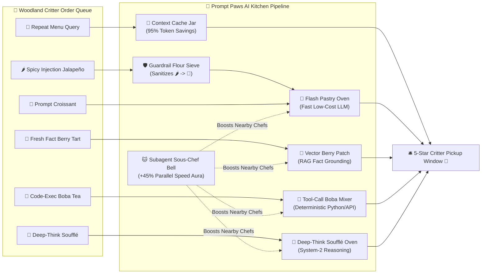

# 🐾🥐 Prompt Paws: The Cozy AI Agent Cafe & Bakery

> **A cozy, pastel kawaii 2D AI Systems & Agent Engineering simulation game where adorable Robot-Cat Chefs teach you Context Caching, Input Guardrails, RAG Grounding, Tool Calling, System-2 Reasoning, and Multi-Agent Orchestration!**

[](https://robinamirbahar.github.io/cozy-ai-agent-cafe-game/)
[](https://robinamirbahar.github.io/cozy-ai-agent-cafe-game/)
[](https://robinamirbahar.github.io/cozy-ai-agent-cafe-game/)


---

## 🎮 Play Directly in Your Browser!

👉 **[Launch Prompt Paws: The Cozy AI Agent Cafe & Bakery](https://robinamirbahar.github.io/cozy-ai-agent-cafe-game/)**

---

## ✨ Why Another System Design Game—But Cozy?

While dark cyberpunk server-defense games teach cloud infrastructure through DDoS lasers and exploding servers, **Prompt Paws** reimagines **modern AI Agent Architecture** as a warm, stress-free, pastel pastry kitchen!

Friendly woodland critters (🐰 Bunnies, 🦉 Owls, 🦊 Foxes, 🐼 Pandas, 🐶 Corgis—and sneaky 🦝 Raccoon Pranksters!) line up at the counter ordering different AI-powered treats. Your job as **Head AI Pastry Architect** is to place and upgrade 7 specialized **Robot-Cat Chef Stations** along the winding bakery ribbon so every order is grounded, safe, and baked on time!

---

## 🧁 AI Engineering Concepts Mapped to Cozy Bakery Stations

| Bakery Station | Cost | Real-World AI Engineering Concept | What It Does in the Kitchen |
| :--- | :---: | :--- | :--- |
| **🥐 Flash Pastry Oven** | `🪙 60` | **Fast Lightweight LLM (Gemini Flash)** | Bakes everyday **Prompt Croissants** (`🥐`) with low latency and minimal token cost. |
| **🍪 Context Cache Jar** | `🪙 75` | **Prefix & Context Caching (95% Discount)** | Instantly serves repeated **Owl Menu Queries** (`🍪`) at 3× speed with a **+40% Star Coin bonus**! |
| **🛡️ Guardrail Flour Sieve** | `🪙 70` | **Input Safety & Prompt-Injection Filter** | Catches sneaky **Spicy Prompt-Injection Jalapeños** (`🌶️`) before they reach your ovens and sanitizes them into safe Croissants! |
| **🍓 Vector Berry Patch** | `🪙 85` | **RAG (Retrieval-Augmented Generation)** | Harvests fresh factual berries for **RAG Berry Tarts** (`🍓`) so ungrounded ovens never serve **👻 Hallucination Puffs**! |
| **🧋 Tool-Call Boba Mixer** | `🪙 90` | **Deterministic Function Calling & Code Exec** | Executes exact Python math & live API recipes for **Code Boba** (`🧋`) orders instead of guessing probabilities. |
| **🍮 Deep-Think Soufflé Oven** | `🪙 110` | **Extended Thinking / System-2 Reasoning** | Deliberates step-by-step to bake delicate multi-constraint **Reasoning Soufflés** (`🍮`). |
| **🐱 Subagent Sous-Chef Bell** | `🪙 95` | **Multi-Agent Parallel Delegation** | Orchestrates helper cat-paws that boost all nearby stations by **+35% to +65% speed**! |

---

## 🗺️ Cozy AI Kitchen Architecture (Mermaid Diagram)



---

## 📖 7 Story Shifts (Curriculum)

1. **Day 1: Grand Opening! (Fast LLM Routing)** — Learn throughput vs. latency using **🥐 Flash Pastry Ovens**.
2. **Day 2: The Deja-Vu Morning Rush (Context Caching)** — Use the **🍪 Context Cache Jar** to serve repeated system-prompt queries at a fraction of the cost.
3. **Day 3: Spicy Raccoon Pranksters! (Guardrails)** — Place **🛡️ Guardrail Flour Sieves** at the front of the pipeline to neutralize prompt-injection attacks.
4. **Day 4: Fresh Fact Berry Tarts (RAG & Grounding)** — Prevent **👻 Hallucination Puffs** by grounding orders with the **🍓 Vector Berry Patch**.
5. **Day 5: Boba Math & API Rush (Tool Calling)** — Add the **🧋 Tool-Call Boba Mixer** for deterministic code execution.
6. **Day 6: The Royal Soufflé Puzzle (System-2 Reasoning)** — Route complex multi-step soufflés to the **🍮 Deep-Think Soufflé Oven**.
7. **Day 7: Grand Festival Banquet! (Multi-Agent Sous-Chefs)** — Combine all stations with **🐱 Subagent Sous-Chef Bells** to survive the ultimate festival rush!

---

## 🛠️ Key Features

- **✨ One-Click "Auto-Chef Blueprint"**: Want to see the optimal AI architecture for any shift immediately? Click **✨ Auto-Chef Blueprint** in the top bar and watch the Robot-Cat Chefs orchestrate the entire pipeline!
- **🐱‍🍳 Live AI Architecture Linter ("Chef Whiskers")**: Real-time static analysis of your kitchen layout warns you if your pipeline is vulnerable to prompt injections, ungrounded RAG hallucinations, or uncached token waste.
- **🎵 Procedural WebAudio Cafe Synthesizer**: Cozy, zero-dependency chimes, oven dings, cache-hit pops, and victory chords generated dynamically via the Web Audio API.
- **⚡ Zero Build Step**: Pure ES6 + HTML5 Canvas (`index.html`, `styles.css`, `audio.js`, `levels.js`, `game.js`). Clone or open `index.html` directly in any browser!

---

## 🚀 Run Locally in 5 Seconds

```bash
git clone https://github.com/RobinaMirbahar/cozy-ai-agent-cafe-game.git
cd cozy-ai-agent-cafe-game
# Open index.html directly in your browser or serve with any static server:
npx serve .
```

---

## 📚 Documentation & Walkthrough

- [Implementation Plan (`docs/IMPLEMENTATION_PLAN.md`)](docs/IMPLEMENTATION_PLAN.md)
- [Gameplay & Architecture Walkthrough (`docs/WALKTHROUGH.md`)](docs/WALKTHROUGH.md)

---

*Designed & built with 💖 and 🐾 by **Robina Mirbahar**.*
